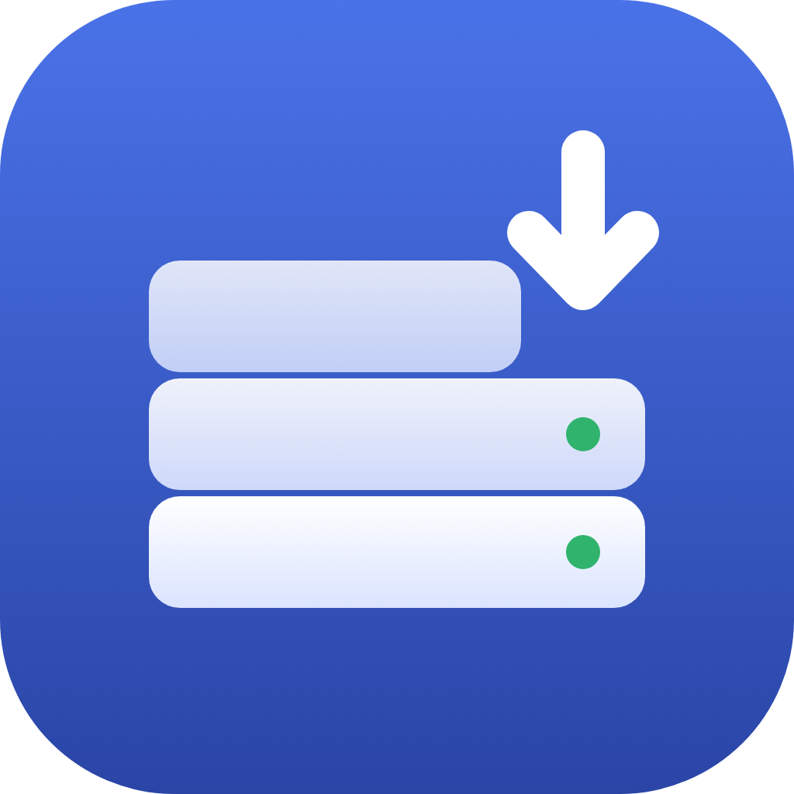
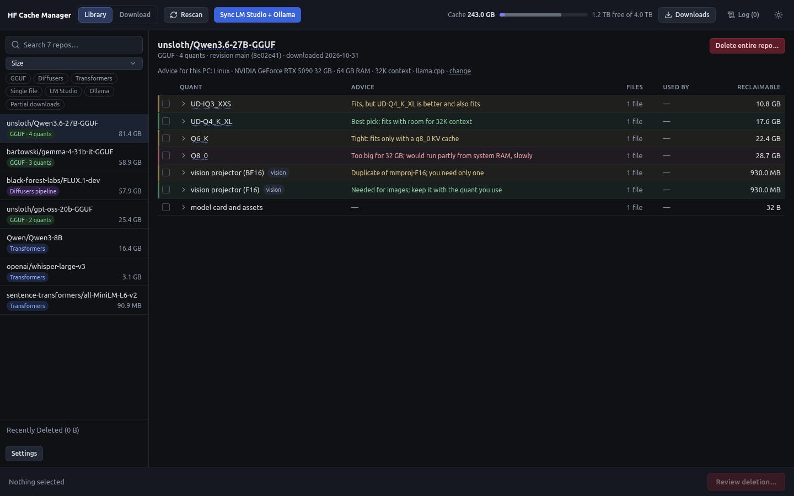
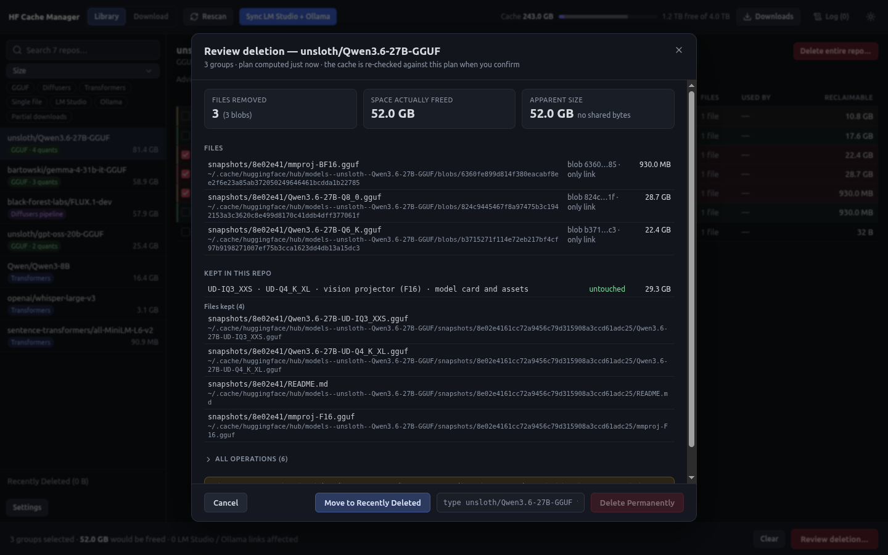
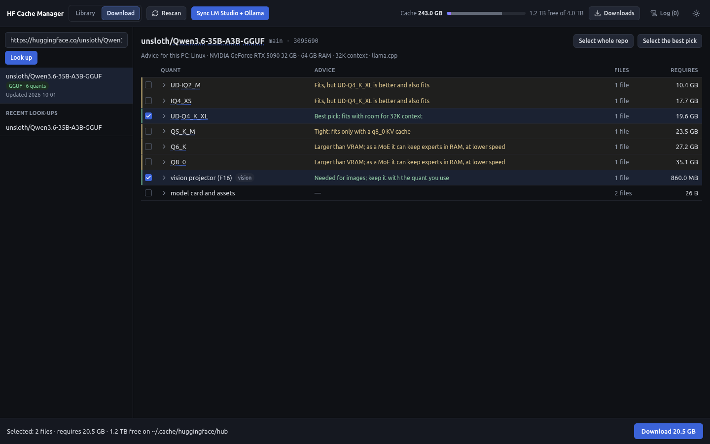

<p align="center">
  
</p>

<h1 align="center">HF Cache Manager</h1>

<p align="center">
  A desktop app for the local Hugging Face model cache.<br>
  See what is really on disk, get keep-or-delete advice for <em>your</em> machine, reclaim space safely,
  and download exactly the files you need.
</p>

<p align="center">
  <a href="https://github.com/StephenGenusa/hf-cache-manager/releases/latest"></a>
  <a href="LICENSE"></a>
  
  
  
</p>



## Contents

- [Why](#why)
- [Features](#features)
- [Install](#install)
- [Using it](#using-it)
  - [The library](#the-library)
  - [Deleting safely](#deleting-safely)
  - [Recently Deleted](#recently-deleted)
  - [Download mode](#download-mode)
  - [Sync with LM Studio and Ollama](#sync-with-lm-studio-and-ollama)
- [Configuration](#configuration)
- [Privacy and network use](#privacy-and-network-use)
- [Known limitations](#known-limitations)
- [Building from source](#building-from-source)
- [License](#license)

## Why

The Hugging Face cache (`~/.cache/huggingface/hub`) is a folder of content hashes and snapshot ids. Sort it by size
and you see `models--unsloth--Qwen3.6-27B-GGUF` at 81 GB, but not that it holds four quants, two vision projectors and
a model card, which of those your GPU can actually run, or how much space deleting one would really give back once
shared and hard-linked files are counted.

HF Cache Manager reads the cache the way `huggingface_hub` writes it, shows every repo by name with its contents in
human terms, and turns "delete the biggest folder and hope" into a reviewed, reversible operation.

## Features

- **A readable library.** Every cached model, dataset and space by name, with its real on-disk size, its kind (GGUF
  quants, a diffusers pipeline, transformers weights, a single file) and whether LM Studio or Ollama uses it. Search,
  sort and filter by kind, by tool, or by repos with unfinished downloads.
- **Contents in human terms.** A GGUF repo shows its quants, vision projectors and draft models; a pipeline shows its
  components (`transformer/`, `vae/`, `text_encoder/`); sharded weights are one group, not twenty files. No hashes in
  the main view.
- **Keep advice for this PC.** Each quant gets a green, yellow or red verdict from its real model shape (read from the
  GGUF header) against your GPU memory, RAM, context length and KV-cache type: *fits with room*, *tight*, or *too big;
  would run partly from system RAM*. Mixture-of-experts models, duplicate projectors and formats your tools cannot load
  are called out. Non-GGUF repos get one judgment for the whole repo.
- **Name hints.** Hover any part of a file name (`UD`, `IQ4_XS`, `Q6_K`, `mmproj`, `-it`) for what it means.
- **Deletion you can trust.** Pick whole repos or individual quants. A review lists every file that will go and every
  file that stays, the space *actually* freed (hard links and shared blobs counted once) and any LM Studio or Ollama
  links affected. The cache is re-checked against the plan at the moment you confirm.
- **Recently Deleted.** Deletions are held in an app-managed area on the same disk and can be restored with one click.
  They are emptied automatically after 14 days (configurable, or never). Permanent deletion needs a typed
  confirmation.
- **Download mode.** Paste a repo id or any Hugging Face URL, see every file with what it *requires* on disk and the
  same keep advice, pick the quant that fits (or let *Select the best pick* do it) and download. Downloads resume,
  are verified against the Hub's SHA-256 before they enter the cache, and land exactly where `hf download` would put
  them.
- **Sync with LM Studio and Ollama.** One button rebuilds the symlink views those apps read, with a preview first;
  your own files in those folders are never touched.
- **Plays well with others.** The cache stays a standard `huggingface_hub` cache. The app reads and writes the same
  `config.toml` and sync state as the `hf-xfer` CLI from [hf-hub-utilities](https://github.com/StephenGenusa/hf-hub-utilities), so either can be used at any time.

## Install

Download the file for your system from the [latest release](https://github.com/StephenGenusa/hf-cache-manager/releases/latest).

| System | File | Notes |
| --- | --- | --- |
| Linux (x64) | `hf-cache-manager-<version>.AppImage` | `chmod +x` it and run it. No install needed. AppImages need FUSE 2 (`libfuse2`, or `libfuse2t64` on Ubuntu 24.04 and later). |
| Windows (x64) | `hf-cache-manager-<version>-setup.exe` | Per-user installer. The build is not code-signed: SmartScreen asks once (*More info*, then *Run anyway*). |
| macOS (x64) | `hf-cache-manager-<version>-mac-x64.zip` | Unzip and move the app to Applications. It is not notarized: right-click it and choose *Open* the first time, or run `xattr -dr com.apple.quarantine "/Applications/HF Cache Manager.app"`. Runs on Apple Silicon through Rosetta; a native arm64 build can be made with `scripts/build/build-macos.sh`. |

Each release lists the SHA-256 of every file.

## Using it

### The library

The app finds the cache the same way `huggingface_hub` does (see [Configuration](#configuration)) and lists every
repo on the left with its size and kind. The header shows the cache's size against the whole disk. Select a repo to
see its contents grouped on the right; expand a group to see its files.

The advice line above the table names the machine it was judged for: GPU, RAM, context length and the tools you run.
Change any of them under **Settings → Advice** if detection got something wrong or you plan for a different setup.

### Deleting safely

Tick the groups to remove, or use **Delete entire repo…**, then **Review deletion…**.



The review shows:

- every file removed, with the blob it points to and whether another file still links to it;
- the space actually freed, next to the apparent size, so shared data is never counted as reclaimed;
- everything kept in the repo;
- the LM Studio and Ollama links that would break, and every low-level operation if you want to see them.

Nothing changes until you confirm. If the cache changed since the review was made (a download finished, another
program deleted something), the plan is refused and you are asked to review again.

### Recently Deleted

**Move to Recently Deleted** moves the files, by rename only, into `.hf-cache-manager/recently-deleted/` next to the
cache folder: on the same disk, outside the cache, so no other tool sees them as a repo. Restore puts them back and
offers a Sync to recreate any LM Studio or Ollama links. **Permanently Delete Recent Deletions** frees the space now;
otherwise held deletions are emptied after the number of days set in Settings.

### Download mode

Switch to **Download**, paste `org/name`, `org/name@revision` or a Hugging Face URL (with or without `https://`), and
press Enter.



- **Requires** is what each group still needs on disk: files already in the cache count as zero, partial downloads
  count only what is left.
- **Select the best pick** ticks the quant and projector that fit this machine best; **Select whole repo** ticks
  everything not yet downloaded. Files already in the cache, or already in the download queue, cannot be ticked again,
  and the list updates as downloads finish.
- The footer checks free space before you start, keeping a 5 GB margin.
- The **Downloads** panel shows progress, speed and time left, with Pause, Resume and Cancel (Clear removes a finished
  download from the list). Unfinished downloads
  come back paused after a restart, and a repo with a download in progress cannot be deleted.

Gated repos need a Hugging Face token: set `HF_TOKEN`, or log in once with `hf auth login` so the token is in
`~/.cache/huggingface/token`. The token is only ever sent to the Hub.

### Sync with LM Studio and Ollama

If you keep LM Studio or Ollama pointed at your Hugging Face models through symlink views (the layout `hf-xfer sync`
from [hf-hub-utilities](https://github.com/StephenGenusa/hf-hub-utilities) builds), **Sync LM Studio + Ollama** shows exactly which links it will add and remove, then applies them. It only
removes links it created itself; anything you put in those folders by hand is left alone.

## Configuration

**Cache location.** Resolved like `huggingface_hub`: `HF_HUB_CACHE` (or `HUGGINGFACE_HUB_CACHE`), else
`$HF_HOME/hub`, else `$XDG_CACHE_HOME/huggingface/hub`, else `~/.cache/huggingface/hub`. Set the variable before
starting the app to manage a cache on another drive.

**LM Studio and Ollama views.** Sync reads `~/.config/hfhub/config.toml` (override with `HFHUB_CONFIG`), the same file
the `hf-xfer` CLI uses:

```toml
[views.lmstudio]
root = "~/.lmstudio/models"

[views.ollama]
root = "~/.ollama/models"
```

Without this file the app works as a cache manager and Sync stays off.

**Offline.** `HF_HUB_OFFLINE=1` turns download mode off. `HFCM_OFFLINE=1` also keeps Sync from contacting the Ollama
registry; it then links only what it can build from the cache.

**GPU detection.** `HFCM_NO_GPU_DETECT=1` skips the `nvidia-smi` call; enter the GPU under **Settings → Advice**
instead.

**Settings** (in the app) shows the folders in use and holds the Recently Deleted retention period and the advice
inputs: GPU memory and type, RAM, whether the GPU drives the display, context length, KV-cache type and the tools you
run (llama.cpp, LM Studio, Ollama, vLLM, TabbyAPI, transformers).

## Privacy and network use

There is no account, no telemetry and no update check. The app goes online only:

- in download mode, to the Hugging Face Hub, to look up the repo you enter, read GGUF headers for advice, and download
  the files you choose;
- during Sync, to Hugging Face's Ollama registry endpoint, for the manifest of a model Ollama will link to.

GPU detection runs `nvidia-smi` locally when it is installed. Settings and the download queue are kept in the app's
own settings folder; nothing leaves the machine.

## Known limitations

- **Unsigned builds.** The Windows installer is not code-signed and the macOS app is not notarized, so SmartScreen and
  Gatekeeper ask once on first launch (see [Install](#install)). The macOS download is an x64 build that runs on Apple
  Silicon through Rosetta.
- **On macOS the menu bar shows `hf-cache-manager`** rather than the full product name; this keeps the settings folder
  stable across versions.
- **Downloads pinned to a commit** (`org/name@<40-hex commit>`) are listed as an older revision once a newer one is
  cached, the same way `huggingface_hub` treats them.
- **Deleting every file of a branch or tag's snapshot** can leave that ref pointing at a snapshot that no longer exists.
- **The "Files only in <ref>" group label** can be inaccurate when files are shared between refs.
- **`HF_HUB_OFFLINE=1`** turns off download mode but not Sync's Ollama registry lookups; use `HFCM_OFFLINE=1` for that
  (see [Configuration](#configuration)).

## Building from source

Requires Node.js 22 or later.

```sh
npm ci
npm run dev          # the app with hot reload
npm test             # unit and integration tests (Vitest)
npm run e2e          # end-to-end tests against the built app (Playwright; xvfb-run on a headless Linux)
npm run lint
npm run typecheck
```

Release builds, which install from the lockfile, run lint, the type check and the tests, package, and print each
artifact's size and SHA-256:

```sh
scripts/build/build-linux.sh                                   # AppImage, on Linux
scripts/build/build-macos.sh                                   # dmg + zip, x64 and arm64, on a Mac
powershell -ExecutionPolicy Bypass -File scripts\build\build-windows.ps1   # NSIS installer, on Windows
```

From Linux, `npm run build:win` (needs Wine) and `npm run build:mac` (an unsigned x64 zip) cross-build the other two.
Output goes to `dist/`. `npm run screenshots` regenerates the images in this README from a generated sample cache.

The code is TypeScript throughout: an Electron main process that owns every file-system change through a single
guarded writer, a React renderer, and a core library (scanner, classifier, deletion planner and executor, advice
engine, Hub client) that is tested on its own, including property-based and mutation testing of the deletion path.

## License

[MIT](LICENSE) © 2026 Stephen Genusa
